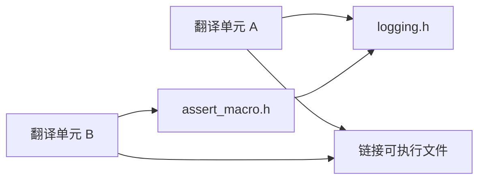
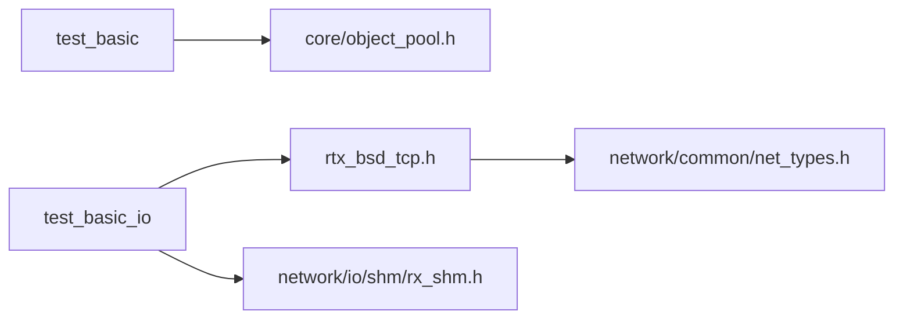

# basic 本地代码审查

## Part A · 范围与行为

2026-11-19 在 Linux x86-64 审查当前 basic 工作树。HEAD 为 `d29187ee231a16862797165a43723736f9771e65`。以连续两次 0.2.0 提交前的 `e422aec14829e563c5533f7df71f15bba9eabf99` 辅助判断问题来源。当前工作树额外包含暂存的 `spinlock_t` 别名及未跟踪的 README 和 docs。本次按用户指定的模块进行抽查。未提供远端 PR/MR 编号，作者讨论、远端 CI 及平台审批状态未知。

| 模块 | 当前行为及审查边界 |
| --- | --- |
| concurrency、ipc | 分片 MPSC 为各生产者分配 SPSC 环，单消费者按位图轮询。命名锁在 Linux 使用文件描述符加锁。两条路径均做了定向验证。 |
| base、logging、buffer、memory | 公共头直接进入调用方的翻译单元。检查了跨翻译单元链接、内联存储的复制语义及分配失败后的状态。 |
| config、container、time、execution、io | 核对了配置节点、容器、定时器、执行器和 I/O 的实现或调用关系，运行各模块现有测试。 |
| 构建与兼容 | 0.2.0 调整头文件路径和模块目标。README 说明调用方须迁移旧 include。另行检查 Git 已提交文件能否构建测试。 |

**数据流。** 省略令牌的写入接口在首次调用时注册线程。槽位安全复用取决于环始终由单个生产者写入。

**构建架构。** 头文件在每个包含它的翻译单元编译。下图两条路径汇合时触发 B3。

**测试组件依赖。** 下图列出在工作区中可解析、在审查提交中缺失的依赖。

**性能与讨论。** 生产者注册是首次使用路径，写环、发布位图与消费是逐次操作。此次未测吞吐或延迟。目录迁移动机依据本地 README；没有可用于核对作者意图的 PR 讨论。

## Part B · 按严重程度排序的发现

### P1 · 阻塞

1. **B1 并发 · 分片队列在地址复用后接受未注册的生产者。** [sharded_mpsc_queue.h:229](basic/concurrency/queue/sharded_mpsc_queue.h#L229) 的线程缓存只比较队列地址。实测用 `std::optional<ShardedMpscQueue<int,2,8>>` 在原位重建队列，让两个存活的线程各注册一个分片。曾在旧队列写入的第三个线程显式注册失败，但 `try_push(2)` 返回成功。这绕过了新队列的注册表，使第三个线程能和合法持有者同时写一个 SPSC 环，造成消息覆盖的可能。队列实现于参考基线之后进入 basic。建议给实例增加可验证的生命周期标识，或取消跨实例隐式令牌缓存，并固化该重建测试。
2. **B2 并发 · Linux 上同一 ipc_lock 实例不能互斥两个线程。** [ipc_lock.h:141](basic/ipc/ipc_lock.h#L141) 对实例持有的同一 fd 调用 flock。主线程先 lock 并保持持锁，再启动子线程；子线程 try_lock 实测返回 true，且其 unlock 能释放主线程依赖的文件锁。调用方按类注释中的 Lockable 契约使用时，两者可以同时进入临界区。当前 basic 公开此类。建议协调实例内互斥与文件锁，确保 unlock 在释放两层锁时保持正确次序，并覆盖同实例双线程及独立打开文件的双进程两种情况。
3. **B3 兼容 · 日志头导致普通多文件程序链接失败。** [logging.h:21](basic/logging/logging.h#L21) 在头文件中定义具有外部链接的全局 gettid。一个 .cpp 包含日志头，另一个包含 base/assert_macro.h，用 GCC 15.2.1 链接即报 `multiple definition of gettid`。单个翻译单元无需调用日志宏即可触发。旧版日志头已有该定义。建议使用项目命名空间中的 inline 辅助函数，或直接调用平台提供的函数，并增加双翻译单元链接检查。
4. **B4 正确性 · StagingBuffer 的默认复制让副本写入原对象。** [staging_buffer.h:23](basic/buffer/staging_buffer.h#L23) 把游标初始化为自身数组地址，隐式复制会原样复制这些地址。实测复制空的静态存储期源对象后，两对象第一次 allocate(1,false) 返回同一地址；源对象销毁后，副本游标会悬空。该缺陷在目录迁移前已存在。建议禁止复制；若需要值语义，须根据源偏移重建全部游标并验证独立写入。
5. **B5 构建 · 已提交源码无法构建两个默认测试目标。** [test_object_pool.cpp:1](basic/test/test_object_pool.cpp#L1) 依赖未跟踪的 core/object_pool.h。[test_backends.cpp:9](basic/io/test/test_backends.cpp#L9) 依赖未跟踪的 network/io/shm/rx_shm.h，TCP 后端还依赖未跟踪的 network/common/net_types.h。用 git archive HEAD 提取 basic、core、network，关闭四种可选配置格式后配置成功；分别构建 test_basic 和 test_basic_io，编译器分别报告缺少 object_pool.h 和 net_types.h。建议将实际依赖随版本交付，或把需要外部实现的集成测试注册在显式提供这些依赖的构建中，再用干净检出验证。

### P2 · 需修复

6. **B6 正确性 · 构造异常永久消耗 Allocator 的槽位。** [allocator.h:45](basic/memory/allocator.h#L45) 先 pop 再 placement new。实测容量为 1，第一次 T 构造抛异常，第二次用正常参数调用仍返回 nullptr。基线已有同样的顺序。建议保证构造失败时槽位可再用，并用同一个分配器验证异常后的成功重试。
7. **B7 正确性 · ConfigNode 将已赋值的标量报告为空。** [config_parser.h:117](basic/config/config_parser.h#L117) 对所有持有有效值的内层 variant 都返回 true。实测 ConfigNode(42).empty() 返回 true，调用方据此判断有无配置时会忽略有效值。基线已有该判断。建议先定义空字符串、null 和默认节点的语义，用例同时覆盖 0、false、42、非空字符串与空容器。
8. **B8 正确性 · StagingBuffer 首次分配读取未初始化的计数。** [staging_buffer.h:76](basic/buffer/staging_buffer.h#L76) 在成功分配后执行 ++num_allocates_，构造函数和成员声明均未初始化该字段。自动存储期对象的第一次成功分配即读取不确定值。此项由 C++17 初始化规则和源码判定，基线已有。建议删除未使用的计数，或在定义处置零。

### 验证与结论

| 验证场景 | 结果及覆盖边界 |
| --- | --- |
| 当前工作区，GCC 15.2.1，C++17，Debug，BASIC_BUILD_EXECUTION=ON | CMake 默认生成器构建成功。限制网络的沙箱中 13/14 组通过，I/O 组 3 个用例失败；在允许本地套接字的环境中完整重跑，14/14 组通过。 |
| 临时消费者程序 | 验证了 B1、B2、B3、B4、B6、B7；并发程序验证错误准入，未用压力测试估算数据损失概率。 |
| Git 归档与静态检查 | 干净归档复现 B5，源码判定 B8。未运行 Windows/ARM、完整 sanitizer 套件或性能基准。 |

**BLOCK**。优先处理生产者与锁的错误准入、公共日志头的链接错误、缓冲区复制和干净检出的构建失败。阻塞结论针对当前 basic 模块；暂存的 spinlock_t 别名只增加类型别名，未发现由这两行引入的问题。
