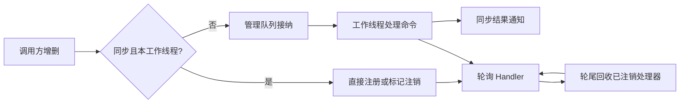
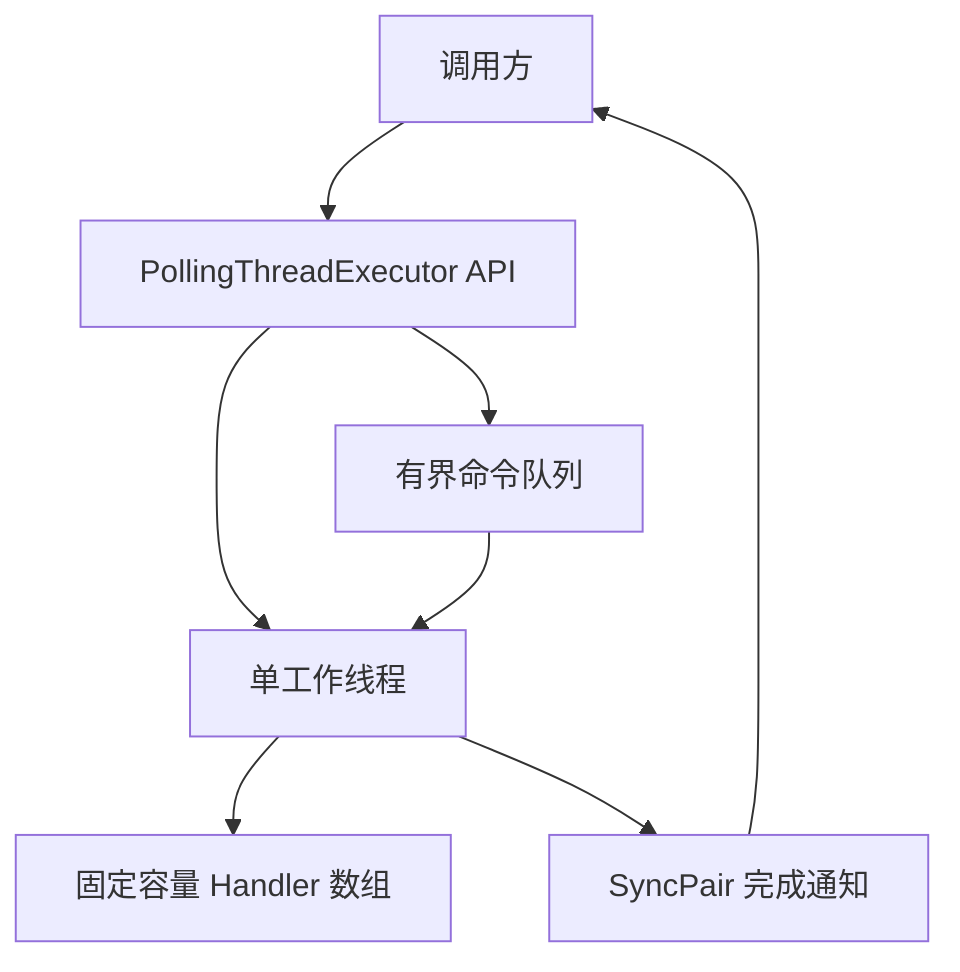
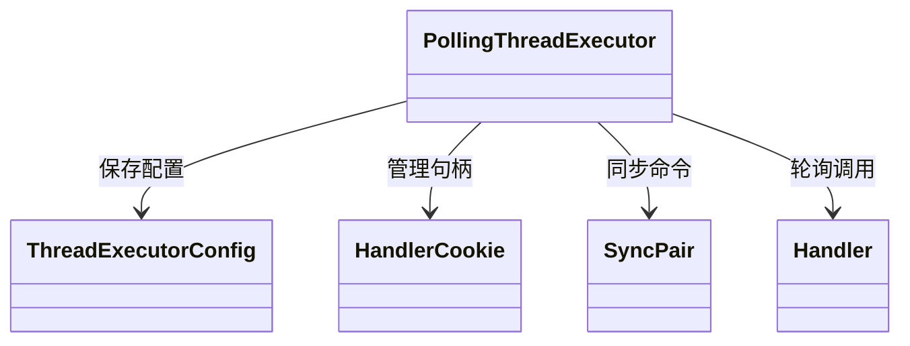

# PollingThreadExecutor 本地变更审查

## Part A：变更理解

### 1. 总结

- 审查对象：`basic/threadpool/` 下全部新增文件，以及关联设计文档 `threadpool/polling_thread_design.md`；这些文件在审查时均未被 Git 跟踪。
- 基准：`e422aec14829e563c5533f7df71f15bba9eabf99`（当前 HEAD）；该基准中没有这套新实现。本报告不是 PR/MR 审查：链接、编号、作者描述、提交、讨论及平台 CI 均不适用或未知。
- 审查时间：2026-10-29 22:17 +08:00。工作区内容并非 Git 提交，以下 SHA-256 用于标识审查版本，不能保证文件以后不变。
- 结论：**NEEDS Work**。示例不能编译；设计文档中的停止接口与用户确认的约束不一致。

| 文件 | SHA-256 |
|---|---|
| basic/threadpool/CMakeLists.txt | `94959a03221a71bf48094c0e2808c631e1f2f8d7c462275f93d4a88183b3d77b` |
| basic/threadpool/README.md | `2c3384c625419b1fce8c8b3545e61fd3b468e90f92e392b38fccbdbb455c540e` |
| basic/threadpool/polling_thread_executor.h | `95bcced9168df2677326455fd7c231852c9d770e27a87d61610081bd83aaf8b7` |
| basic/threadpool/polling_thread_executor.cpp | `e66c577c268c860fe90b22c86a7adebc92f0ec593ed72fcd9d4b507e5c2f52b1` |
| basic/threadpool/sync_pair.h | `c06eeec9967975febb4833015c57124100e56f7f4b45c050b1192c5a88a8236a` |
| basic/threadpool/test/test_polling_thread_executor.cpp | `6d4716548a649703a2bd00154a63515a1a89f59512650176007d564178ae9d6f` |
| basic/threadpool/test/test_sync_pair.cpp | `760d63c9615be8745aac3165c360dc055433f457371cb81c06b1bcb6d76a60c3` |
| threadpool/polling_thread_design.md | `83b68eba87830383a51e952d018d7a34f0eece1321e9781ccca26477c74a023e` |

### 2. 背景和动机

设计文档说明目标是 Linux/x86 单线程、低时延轮询执行器，处理器持续调用，支持线程配置及外部管理。README 称第一版根据后续决定简化了查询和诊断。用户已确认不允许在 Handler 中请求执行器停止，设计文档中相反的描述已过时。HEAD 中已有独立的 `threadpool/executor`，但本次材料没有证明它是直接替换对象。

### 3. 修改代码分析

| 模块/文件 | 新增内容及行为 | 影响与证据 |
|---|---|---|
| `polling_thread_executor.h/.cpp` | 配置、启动握手、固定 512 个处理器、管理队列、轮询和停止收尾 | README 与实现 206–650 行；外部同步增删等待完成，回调内同步增删直接执行 |
| `sync_pair.h` | 用 ID、共享状态与条件变量协调同步命令 | 58–101、160–185 行；先准备再提交，结果消费后回收 |
| `CMakeLists.txt`、`test/` | 独立库、两组测试及故障注入 | 编译成功，CTest 两项通过；无法替代负载及所有并发时序验证 |
| README、设计文档 | 用法、生命周期和设计约束 | README 示例与头文件不符；设计的停止接口有差异，见 Part B |

业务/数据流程：

架构：

组件关系：

### 4. 技术原理及性能

管理队列最多容纳 1024 条待完成命令，每轮预算 64 条；处理器容量 512。无管理操作时轮询路径调用已注册回调并执行 pause 或休眠。轮询是潜在关键路径，尚无业务 profile 或性能测量；无法确认实际热点、延迟或相对基准的收益。停止关闭接纳，处理已接纳命令并回收处理器；已进入的休眠不被唤醒。

### 5. 讨论亮点

无 PR 评论可供审查。用户在本次审查中确认，不允许在 Handler 中请求执行器停止；设计文档的 `RequestStop` 描述应据此更新。

### 6. 风险表

| 风险 | 触发条件和影响 | 证据/验证或缓解 |
|---|---|---|
| 示例不可编译 | 使用 README 代码时构建失败 | 编译器错误；修正字段并编译示例 |
| 停止契约文档过时 | 使用设计文档编写回调内停止逻辑，误以为可以调用 `RequestStop` | 设计文档 102–103、476–478 行；用户确认 Handler 中不允许请求停止，应同步设计与验收条目 |
| 未测性能与极端时序 | 高负载、系统调度、复杂并发 | 未进行基准、sanitizer 或真实业务负载验证；针对目标环境测量 |

## Part B：审查结论

### P2 · 文档/可用性：README 示例使用不存在的配置字段

- 位置：`basic/threadpool/README.md:25`，公开定义 `basic/threadpool/polling_thread_executor.h:60`。
- 条件与路径：调用方复制 README 中完整示例并按所示包含头文件编译；示例赋值 `config.executor_name`，实际字段为 `name`。
- 后果及证据：`c++ -std=c++17 -I basic/threadpool -fsyntax-only /tmp/net-test-threadpool-readme-example.cpp` 返回错误：`ThreadExecutorConfig has no member named executor_name`。
- 建议：将示例与设计中的字段统一为实际公开字段，增加示例编译检查。非阻塞。

### P2 · 文档：设计错误地允许回调内请求停止

- 位置：`threadpool/polling_thread_design.md:102`、`:476`，`basic/threadpool/polling_thread_executor.h:118` 和 `.cpp:372`。
- 条件与路径：调用方依据设计文档在工作线程 Handler 中尝试请求执行器停止。用户已确认此操作不允许；设计却指定可从任意线程调用 `RequestStop() noexcept`，实际没有此 API，且 `Stop()` 在当前工作线程调用会抛 `logic_error`。
- 后果：设计文档误导调用方采用不支持且不允许的停止方式，按文档使用 `RequestStop()` 的代码无法编译。
- 建议：修订设计文档及其验收条目，明确由外部线程请求停止，并删除回调内 `RequestStop()` 的描述。非阻塞。

按类型索引：文档/可用性 2 项；P0/P1/P3 0 项。

**NEEDS Work**：上述文档问题需要处理。验证：Debug 配置及构建成功；`ctest --test-dir /tmp/net-test-threadpool-review-build --output-on-failure` 2/2 通过；README 示例单独编译失败如上。没有运行 sanitizer、性能测试、不同权限/CPU 环境测试；未审查其他未提交模块、平台讨论或 CI。设计和 README 均为本地未跟踪文件；Handler 中不允许请求停止的约束由用户确认。
